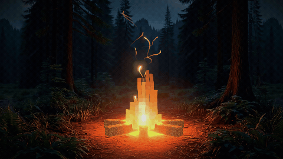

# AI Bonfire



A Minecraft-style bonfire in a photoreal night forest, made to set the mood at the AI Bonfire community meetup. It is a single web page: no build step, nothing loaded from the internet.

## Run it

```bash
python3 -m http.server 8123
```

Then open <http://localhost:8123> and press <kbd>F</kbd> for fullscreen.

## Controls

| Input | What it does |
| --- | --- |
| Mouse | Moves the camera; it also drifts on its own |
| Click or <kbd>Shift</kbd> | Stokes the fire: a quick flare, a slow settle, then a short lull |
| <kbd>Space</kbd> | Opens the tuning panel |
| <kbd>Esc</kbd> | Closes the tuning panel |
| <kbd>F</kbd> | Toggles fullscreen |

Browsers keep audio silent until the first click or key press, so the sound starts with your first one.

## Tuning

The panel has dials for the scene, fire, sparks, camera, look and sound. Changes apply live and are saved in the browser, so they survive a reload but stay on that browser and address. The built-in defaults are the list at the top of the script in [index.html](index.html).

## Sound

The page plays one of the `.mp3` files in [assets/sound](assets/sound), picked at random each time it opens, and loops it without a seam. Drop more files into that folder and they show up in the panel's Track list after a reload.

The list of files comes from the server's folder listing, which Python's `http.server` provides. On a server without folder listings, replace that lookup in `index.html` with a fixed list.

## How it works

- **Backdrop.** Three versions of the same picture: the full scene, the scene without the nearest plants, and the scene without any near trees. Each is pushed back along the camera's rays by a depth map, so it has real parallax. Where camera movement would smear a layer across a depth edge, that layer tears open and the one behind shows through.
- **Fire.** Square columns whose heights jump in block-sized steps, coloured by height from yellow to dark orange. The core is a half-transparent sheet of glowing blocks, and a heat-haze pass bends the picture above the flames.
- **Sparks.** Each spark is a ribbon drawn along the path it has just flown, computed entirely in a shader.
- **Light.** The painted layers keep their own lighting, and the fire's flickering light is added on top using the shape recovered from the depth maps.

## Rebuilding the backdrop

The depth data in `assets/*-data.png` is built from `plate.jpg`, `mid.jpg` and `bg.jpg`. To rebuild it after changing those images:

```bash
cd tools
npm install
node layers.mjs
```

The first run downloads the Depth Anything V2 Small model. `node_modules` takes about 600 MB and is only needed for this step.

## Credits

- [Three.js](https://threejs.org) r170 and [DialKit](https://www.dialkit.dev) 2.0.2, both MIT licensed, are bundled in [vendor](vendor) with their licence files.
- Depth maps come from [Depth Anything V2](https://github.com/DepthAnything/Depth-Anything-V2).
- The backdrop images and the ambience sounds are AI-generated.

## Licence

© 2026 UX Akademie s.r.o.

- **Code** (`index.html` and everything in `tools`) is under the [MIT licence](LICENSE).
- **Assets** (everything in `assets`, and `preview.gif`) are under [Creative Commons Attribution 4.0 International](assets/LICENSE) (CC BY 4.0). You may share and adapt them, including commercially, as long as you credit **[www.uxwell.cz](https://www.uxwell.cz) by UX Akademie s.r.o.**, link to the licence, and say if you changed anything.
- **Libraries** in `vendor` keep their own licences.
